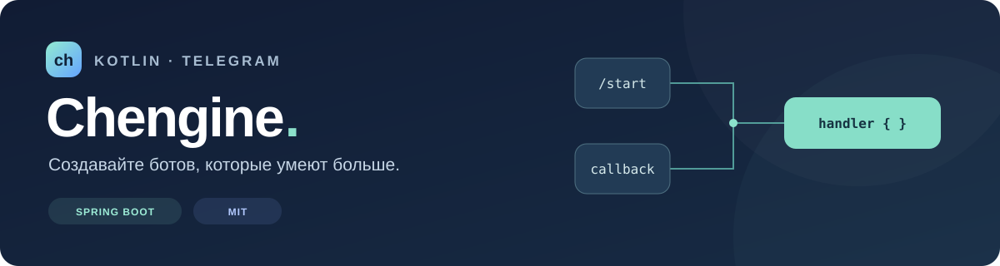

<div align="center">
  
  <p><strong>Команды, кнопки и диалоги — в привычном Kotlin DSL.</strong></p>
  <p>
    <a href="https://chengine-project.github.io/chengine/">Документация</a> &nbsp;·&nbsp;
    <a href="https://chengine-project.github.io/chengine/start/">Быстрый старт</a> &nbsp;·&nbsp;
    <a href="examples/">Примеры</a> &nbsp;·&nbsp;
    <a href="LICENSE">MIT License</a>
  </p>
</div>

---

Chengine — Kotlin-фреймворк для Telegram-ботов со Spring Boot. Опишите обработчик, верните ответ — фреймворк направит событие нужному методу и отправит результат через Telegram Bot API.

```kotlin
@Handler
@Component
class HelloHandler {
    @HandleCommand("/hello")
    fun hello() = sendTelegramMessage {
        text = "Привет! Я работаю на Chengine 👋"
    }
}
```

## Что умеет

| Возможность | Для чего |
| --- | --- |
| **Команды и события** | Обработчики команд, текста, callback, медиа и опросов |
| **Клавиатуры** | Inline-кнопки, ссылки, reply-клавиатуры и редактирование сообщений |
| **Медиа** | Фото, документы, видео, аудио, стикеры и анимации |
| **Диалоги** | Сессии в памяти или PostgreSQL, шаги и данные пользователя |
| **Графы** | Экспериментальные сценарии с ветвлением и ожиданием ответа |

## Быстрый старт

Понадобятся JDK 17+, Kotlin и Spring Boot, а также токен и имя Telegram-бота. Публичный Maven-релиз ещё не настроен, поэтому сначала соберите библиотеку в локальный Maven-репозиторий:

```bash
git clone https://github.com/chengine-project/chengine.git
cd chengine
./gradlew publishToMavenLocal
```

В отдельном Spring Boot-проекте добавьте `mavenLocal()` и зависимость:

```kotlin
repositories {
    mavenLocal()
    mavenCentral()
}

dependencies {
    implementation("io.chengine:spring-boot-starter-telegram:1.0.1-BETA")
}
```

Укажите настройки приложения через переменные окружения:

```yaml
chengine:
  telegram:
    token: ${TELEGRAM_BOT_TOKEN}
    username: ${TELEGRAM_BOT_USERNAME}
```

Добавьте обработчик из примера выше с импортами `io.chengine.command.HandleCommand`, `io.chengine.dsl.sendTelegramMessage`, `io.chengine.handler.Handler` и `org.springframework.stereotype.Component`. Запустите Spring Boot-приложение и отправьте боту `/hello`.

**[Полный быстрый старт →](https://chengine-project.github.io/chengine/start/)**

## Исследуйте примеры

| Пример | Что показывает |
| --- | --- |
| [Каталог](examples/catalog/) | Несколько рядов кнопок, страницы и обновление одного сообщения |
| [Диалог](examples/conversation/) | Имя и город, условный переход и отмена |
| [Медиа](examples/media/) | Отправка файлов и обработка входящих медиа |
| [Опросы](examples/polls/) | Викторины, ответы и исходный чат опроса |
| [PostgreSQL](examples/postgres-sessions/) | Сохранение сессий между перезапусками |
| [Другие примеры](examples/) | Редактирование сообщений, клавиатуры и инструмент для агента |

## Сборка и тесты

```bash
./gradlew build
```

CI проверяет JDK 17 и 21, а интеграционные тесты PostgreSQL запускаются с отдельной базой. [Инструкция по локальной проверке и подготовке релиза](docs/releasing.md).

API развивается. Граф сценариев и инструмент для агента — экспериментальные; интеграции с конкретной LLM пока нет. Постоянное хранилище сессий не координирует параллельную работу разных экземпляров приложения.

---

[Документация](https://chengine-project.github.io/chengine/) · [Исходный код](https://github.com/chengine-project/chengine) · [Лицензия MIT](LICENSE)
